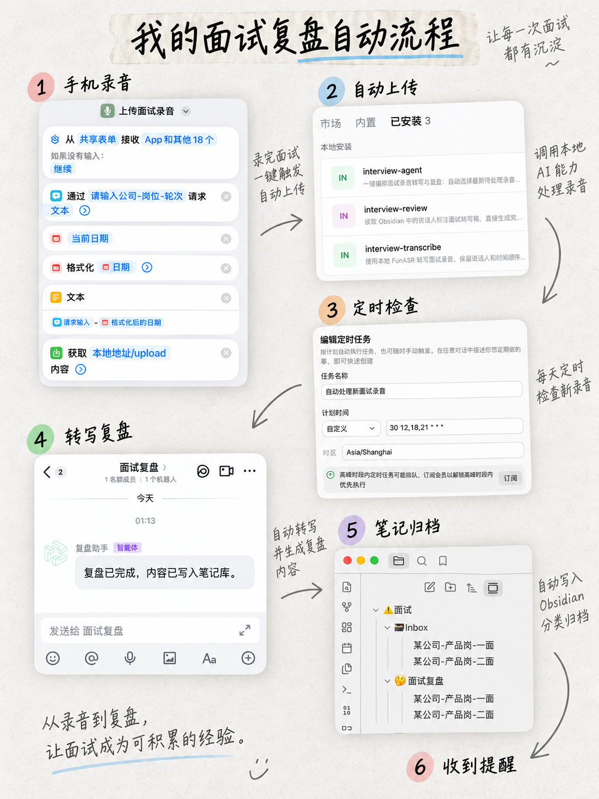

# Interview Review Agent

一套可迁移的面试录音自动转写与复盘工作流。它把手机录音、本地 FunASR、AI 复盘、Obsidian 归档和可选的群聊提醒串成一条可恢复、不会覆盖已有文件的流程。



## 为什么做这个项目

- **控制转写成本**：录音由本机 FunASR 处理，适合反复使用和较长音频。
- **沉淀个人知识库**：复盘以 Markdown 保存，可在 Obsidian 中搜索、修改和长期积累。
- **减少拖延造成的信息损失**：定时检查新录音，尽量在记忆仍清晰时生成第一版复盘。
- **及时核对 AI 判断**：完成后发送简短摘要，方便把 AI 关注点与自己的现场记忆对照，并继续补充复盘。

AI 不替代人的判断。它先完成最容易因忙碌或拖延而被放弃的整理工作，最终复盘仍由使用者核对和修正。

## 工作流

```text
手机录音
  -> 上传到 Mac
  -> 定时任务发现新文件
  -> 本地 FunASR 转写
  -> AI 直接生成 Markdown 复盘
  -> 写入 Obsidian
  -> 可选：发送群聊摘要
```

## 仓库内容

```text
skills/
  interview-transcribe/  选择录音并调用本地 FunASR
  interview-review/      读取逐字稿并生成 Markdown 复盘
  interview-agent/       编排完整流程并发送可选通知
scripts/
  1_transcribe.py        可直接改造的本地 FunASR 转写脚本
  privacy_scan.py        发布前隐私检查
examples/                完全虚构的输入与输出示例
docs/                    架构、安装和隐私说明
assets/                  匿名化流程示意图
```

## 快速开始

### 自动安装本地转写环境（Mac / Linux）

需要 Python 3.10+ 和 FFmpeg（Mac 可使用 `brew install ffmpeg`）。

```bash
git clone https://github.com/desfleurs-yayale/interview-review-agent.git
cd interview-review-agent
bash install.sh
```

脚本创建 `.venv`、安装依赖、检查导入，并在缺少 `.env` 时复制配置模板；重复运行会保留已有配置。
编辑 `.env` 中的录音和知识库路径；含空格的路径请用引号包裹。然后测试：

```bash
bash scripts/run-transcribe.sh "/完整路径/测试录音.m4a" "/完整路径/测试转写.txt"
```

启动脚本会加载本地 `.env` 并使用 `.venv`。首次转写需要联网下载模型。
这只安装本地转写环境：还需在 AI 工作台导入 Skill、配置等效环境变量和定时任务，才能跑通完整复盘流程。

### 手动安装

1. 安装本地依赖：`python3 -m pip install -r requirements.txt`。
2. 复制配置模板：`cp .env.example .env`。
3. 设置录音目录、Obsidian Vault、Inbox、复盘目录和本地转写脚本位置。
4. 在终端或 AI 工作台中加载这些环境变量；项目本身不会自动读取 `.env`。
5. 将 `skills/` 下需要的 Skill 安装到支持 Skill 的 AI 工作台。
6. 验证 `scripts/1_transcribe.py` 能接受音频路径、输出带说话人标签的文本。
7. 可选：配置飞书/Lark CLI 和目标群环境变量。

本仓库不包含 FunASR 模型和个人热词表。`scripts/1_transcribe.py` 是从实际工作流整理出的脱敏通用版本；你可以直接使用，也可以通过 `INTERVIEW_TRANSCRIBE_SCRIPT` 接入自己已验证的脚本。

详细说明见 [安装与配置](docs/setup.md) 和 [架构说明](docs/architecture.md)。

## 隐私与安全

公开仓库不得包含真实录音、逐字稿、复盘、公司信息、姓名、私有路径、IP 地址、群 ID 或密钥。提交前运行：

```bash
python3 scripts/privacy_scan.py .
```

不需要真实录音的基础测试：

```bash
python3 -m unittest discover -s tests
```

## 可替换组件

- AI 工作台可以替换，只要能读取 Skill、访问本地文件并调用脚本。
- Obsidian 只是 Markdown 的管理界面，可替换为其他本地知识库。
- 飞书通知是可选适配器，也可替换为其他消息渠道。
- 复盘阶段直接输出 Markdown，不使用中间 JSON。

## 安装后可以自定义什么？

这套工作流提供的是一套默认配置。你可以按自己的求职岗位、复盘习惯和知识管理工具调整，不必使用完全相同的文稿结构。

| 想调整什么 | 修改哪里 | 示例与说明 |
|---|---|---|
| 录音与文稿保存位置 | 本地 `.env`，以及 AI 工作台中的对应环境变量 | 指定录音文件夹、知识库根目录、转写和复盘子目录；修改后重新加载配置 |
| 本地知识管理工具 | 知识库根目录配置 | 不必使用 Obsidian，也可保存到其他支持本地 Markdown 文件的工具目录或普通文件夹。`OBSIDIAN_VAULT` 是现有变量名，使用其他本地工具时仍沿用该名称 |
| 复盘文稿的结构和长度 | `skills/interview-review/SKILL.md` | 调整章节顺序、逐题字段、表格格式，或改成简洁版复盘 |
| 复盘重点与评价标准 | 同一 Skill 的「逐题分析标准」 | 产品岗侧重需求判断、指标口径和业务价值；技术岗侧重方案正确性、边界条件和技术取舍；也可重点检查表达逻辑与追问应对 |
| 专业术语识别 | `scripts/1_transcribe.py` | 修改 `HOTWORDS` 与 `POSTPROCESS_HOTWORD_MAP`；替换规则会改变文本，建议用短录音核对效果 |
| 自动化频率与通知 | AI 工作台的定时任务、`skills/interview-agent/SKILL.md` 和对应配置 | 调整检查频率、流程顺序，或关闭可选群聊提醒 |

### 可以换成飞书吗？

可以作为扩展方向，但当前仓库默认保存本地文件，已有的飞书功能是**群聊摘要通知**，不包含自动创建飞书云文档。

- **手动归档**：保留本地 Markdown 输出，再把复盘内容复制或导入飞书。
- **自动归档**：需要给 AI 工具接入有文档写入能力的飞书 MCP、CLI 或 API，完成账号授权和目标文档/知识库配置，再修改复盘与编排 Skill 的保存步骤。仅修改 `.env` 路径或 Skill 提示词，不能凭空获得飞书写入能力。
- 如果要完全替换本地归档，还需同步调整「已处理判断、失败重试、来源关联和防重复写入」逻辑；初次接入建议保留本地结果，再增加飞书同步。

### 如何修改复盘 Skill？

可以直接编辑 `skills/interview-review/SKILL.md`，也可以把下面的需求交给 AI 编程工具：

> 请将 interview-review Skill 改成适合产品经理面试的复盘模板。重点分析需求判断、指标口径、项目贡献和追问应对。每题保留原问题、回答摘要、具体不足、优化后的回答和待补充信息；最后汇总最需要改进的 3 个问题和下一场面试前的行动清单。请同步修改「逐题分析标准」「Markdown 模板」和「写入前检查」，避免新旧规则冲突。保留基于原文、不编造经历或数据、不覆盖已有文件的规则。

修改后，将更新的 Skill 重新导入或同步到 AI 工作台实际加载的位置，并按工具要求刷新。仅修改仓库中的文件，不一定会更新已经安装的 Skill。用一份短转写稿测试，确认结构和重点符合预期；已有复盘文稿不会自动改变。

## License

[MIT](LICENSE)
